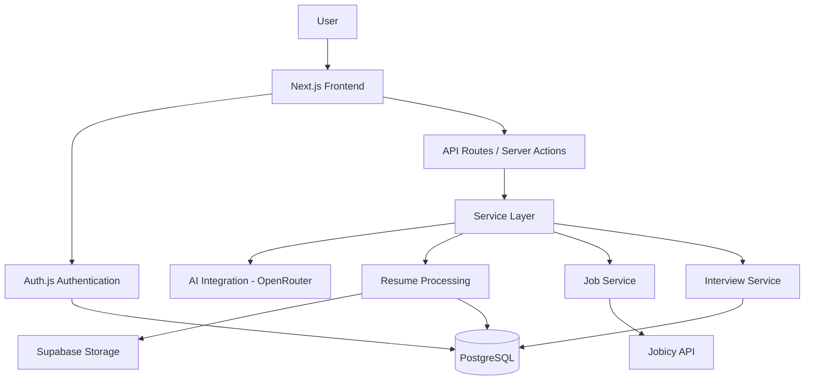
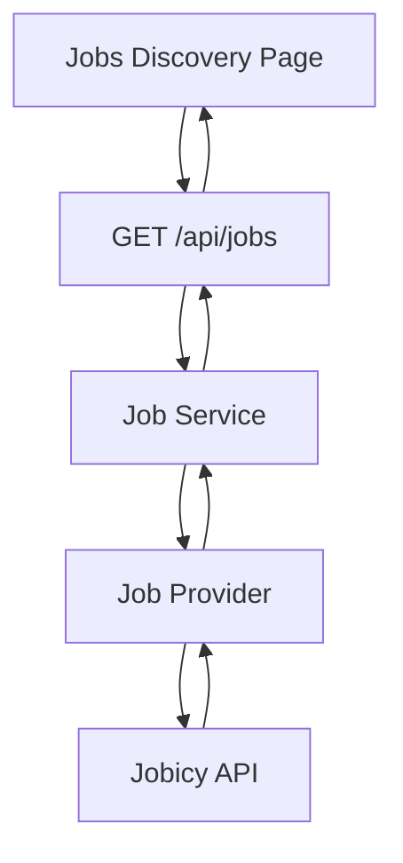

# InterviewAce AI 🚀

**An AI-powered interview preparation platform that helps candidates analyze resumes, discover job opportunities, and prepare for interviews.**

🌐 **Live Demo:** [Add your deployed application URL]

---

## 📌 Overview

InterviewAce AI is a full-stack web application designed to simplify the job preparation process.

Users can upload resumes, analyze their compatibility with job descriptions, discover job opportunities, and generate personalized AI-powered interview sessions based on their resumes.

## ✨ Features

### 1. Authentication & Dashboard
- Google OAuth authentication.
- Personalized user dashboard.
- Centralized access to interviews and resumes.

### 2. Resume Analyzer
- Upload and analyze resumes.
- AI-powered ATS analysis.
- Job description matching.
- Identify missing skills and improvement areas.
- Generate interview preparation topics and likely questions.

### 3. AI Interview Preparation
- Generate interview questions using resume information.
- Answer generated interview questions.
- AI-powered interview evaluation.
- Review previous interview sessions.
- Associate interview sessions with resumes.

### 4. Job Discovery
- Fetch job listings through the Jobicy public API.
- Search opportunities using keywords.
- Display company, job title, location and employment information.
- Open original job listings through external application links.
- Provider-based backend architecture designed to support additional job sources.

## 🛠️ Technology Stack

| Category | Technologies |
|---|---|
| Frontend | Next.js, React, TypeScript, Tailwind CSS |
| Backend | Next.js Route Handlers, Server Actions |
| Database | PostgreSQL, Prisma ORM |
| Authentication | Auth.js, Google OAuth |
| AI Integration | OpenRouter |
| File Storage | Supabase Storage |
| External APIs | Jobicy Jobs API |
| Deployment | Vercel |

## 🏗️ Application Architecture

The application follows a layered architecture that separates the frontend, backend logic, database access and external integrations.



### Job Discovery Architecture

Job providers are separated from the application service layer. This makes it easier to integrate additional job providers without changing the frontend.



## 📁 Project Structure

```text
ai-interview-platform/
│
├── app/
│   ├── api/
│   │   └── jobs/
│   │       └── route.ts
│   └── dashboard/
│
├── components/
│   ├── resume/
│   └── ...
│
├── lib/
│   ├── ai/
│   ├── jobs/
│   │   ├── providers/
│   │   │   └── jobicy.ts
│   │   └── types.ts
│   ├── services/
│   └── ...
│
├── prisma/
│   └── schema.prisma
│
├── public/
├── docs/
│   ├── screenshots/
│   └── demo/
│
├── .env.example
├── package.json
└── README.md
```

## ⚙️ Local Setup

### Prerequisites

- Node.js
- npm
- PostgreSQL database
- Google OAuth credentials
- OpenRouter API access
- Supabase project for file storage

### 1. Clone the repository

```bash
git clone https://github.com/YOUR_USERNAME/ai-interview-platform.git

cd ai-interview-platform
```

### 2. Install dependencies

```bash
npm install
```

### 3. Configure environment variables

Create a `.env` file in the project root.

Refer to `.env.example` for the required configuration.

Configure your database, authentication credentials, AI provider and storage credentials using the environment variable names expected by the application.

**Never commit your actual `.env` file or API secrets.**

### 4. Configure the database

Generate the Prisma Client:

```bash
npx prisma generate
```

Apply the project's database migrations to your local database:

```bash
npx prisma migrate deploy
```

For a fresh local development database where you intend to create new migrations, use:

```bash
npx prisma migrate dev
```

### 5. Start the development server

```bash
npm run dev
```

Open:

http://localhost:3000

## 📸 Application Screenshots

Screenshots of the application will be available here.

| Feature | Screenshot |
|---|---|
| Dashboard | `docs/screenshots/dashboard.png` |
| Resume Analyzer | `docs/screenshots/resume-analyzer.png` |
| Interview Preparation | `docs/screenshots/interview.png` |
| Interview Results | `docs/screenshots/interview-results.png` |
| Job Discovery | `docs/screenshots/job-discovery.png` |

## 🎥 Application Demo

[Watch the InterviewAce AI demo](docs/demo/README.md)

## 🔮 Future Improvements

- Integrate additional job listing providers.
- Advanced job filtering and pagination.
- Resume-to-job compatibility scoring for discovered opportunities.
- Improved interview analytics and preparation insights.

## 👩‍💻 Author

**Shweta Patil**

Full-Stack Software Developer

[LinkedIn](YOUR_LINKEDIN_URL) · [GitHub](YOUR_GITHUB_URL)

---

*InterviewAce AI is a personal full-stack development project built to explore AI integration, application architecture, and modern web development.*
